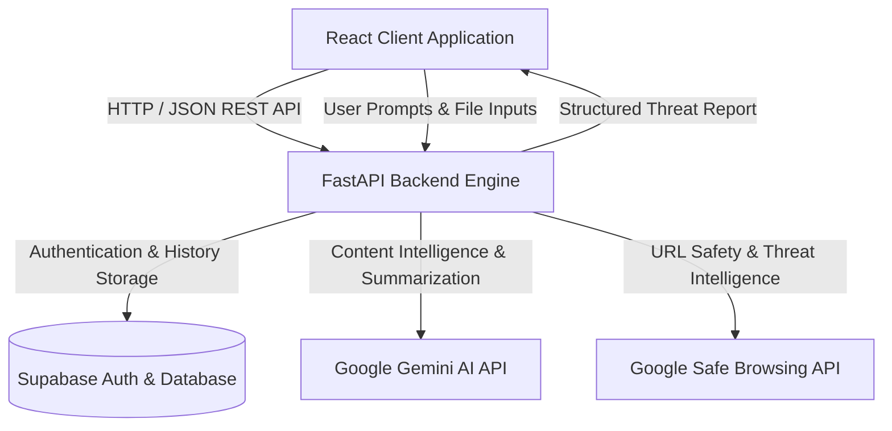
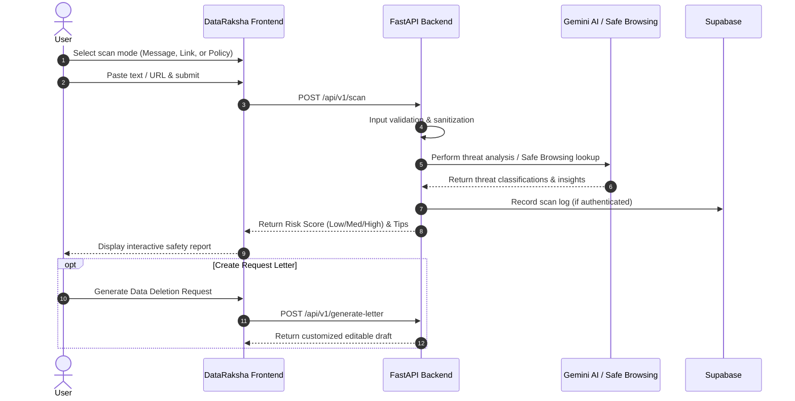

# 🛡️ DataRaksha AI (डेटा रक्षा)

> **AI-Powered Digital Privacy & Risk Protection Platform**  
> Empowering everyday users to detect digital risks, understand complex privacy policies, and safeguard personal information with ease.

[](https://fastapi.tiangolo.com/)
[](https://react.dev/)
[](https://ai.google.dev/)
[](https://supabase.com/)
[](https://developers.google.com/safe-browsing)
[](LICENSE)

---

## 📌 Table of Contents
- [Overview](#-overview)
- [Problem Statement](#-problem-statement)
- [Solution](#-solution)
- [Core Features](#-core-features)
  - [Must-Have Modules (MVP)](#1-must-have-modules-mvp)
  - [Should-Have Features](#2-should-have-features)
  - [Future Scope & Roadmap](#3-future-scope--roadmap)
- [User Roles & Use Cases](#-user-roles--use-cases)
- [System Architecture & Tech Stack](#-system-architecture--tech-stack)
- [User Journey & Workflow](#-user-journey--workflow)
- [Security, Privacy & Edge Cases](#-security-privacy--edge-cases)
- [Scope Boundaries](#-scope-boundaries)
- [Getting Started](#-getting-started)
  - [Prerequisites](#prerequisites)
  - [Environment Variables](#environment-variables)
  - [Backend Setup (FastAPI)](#backend-setup-fastapi)
  - [Frontend Setup (React)](#frontend-setup-react)
- [Project Structure](#-project-structure)
- [Contributing](#-contributing)
- [License](#-license)

---

## 🌟 Overview

**DataRaksha AI** is an intelligent privacy and cyber-risk protection assistant designed to help individuals navigate the complex digital threat landscape. Most people struggle to identify phishing attempts, fraudulent messages, dangerous hyperlinks, and predatory privacy policies hidden in pages of legal jargon.

DataRaksha AI bridges this gap by offering instant, plain-language risk evaluations, a clear Risk Score (Low / Medium / High), actionable safety recommendations, and tools to reclaim digital privacy.

---

## 🛑 Problem Statement

- **Digital Vulnerability:** Millions of internet users are exposed to phishing emails, deceptive SMS messages, and malicious web links daily.
- **Exposed Personal Identifiable Information (PII):** Sensitive credentials, phone numbers, email addresses, and financial tokens are often accidentally shared or leaked without the user's knowledge.
- **Impenetrable Legal Jargon:** Terms of Service and Privacy Policies are deliberately convoluted, leaving users uninformed about how their data is gathered, monetized, and tracked.

---

## 💡 Solution

**DataRaksha AI** provides an all-in-one privacy dashboard that:
1. Scans messages, emails, and URLs for malicious patterns and exposed PII.
2. Breaks down complex privacy policies into concise, readable risk summaries.
3. Quantifies danger with an intuitive **Risk Rating** (Low / Medium / High).
4. Generates customized **Data Access / Deletion Request Letters** to help users enforce their statutory privacy rights.

---

## 🚀 Core Features

### 1. Must-Have Modules (MVP)
* **✉️ Message & Email Checker:**
  - Scans user-provided text/emails for suspicious intent (phishing, social engineering, urgent scam triggers).
  - Flags sensitive personal data leaks (passwords, phone numbers, banking identifiers, emails).
* **🔗 Link & URL Safety Checker:**
  - Validates submitted links using the **Google Safe Browsing API**.
  - Identifies phishing, deceptive domains, malware hosts, and suspicious redirects.
* **📜 Privacy Policy Simplifier:**
  - Ingests lengthy legal privacy terms and translates them into plain language using Google Gemini AI.
  - Highlights red flags: third-party data broker sharing, intrusive telemetry, perpetual data retention, and biometric tracking.
* **📊 Risk Rating Engine & Actionable Advice:**
  - Assigns an immediate **Low / Medium / High** threat rating.
  - Accompanies every assessment with specific, practical mitigation advice (e.g., *"Change password immediately"*, *"Do not click this link"*).

### 2. Should-Have Features
* **📝 Data Request Letter Generator:**
  - Generates ready-to-send, editable legal notices requesting data disclosure or permanent deletion under data protection frameworks (DPDP / GDPR).
* **🕒 Analysis History:**
  - Allows authenticated users to review past scan results, risk levels, and generated reports from their dashboard.

### 3. Future Scope & Roadmap
* **🖼️ Screenshot & Image OCR Analysis:** Multimodal risk scanning directly from mobile/desktop screenshots.
* **🚨 Real-Time Fraud & Breach Alerts:** Proactive breach database monitoring.
* **🧩 Browser Extension & Mobile Application:** On-the-fly URL warnings and privacy summaries while browsing.
* **🏢 Enterprise Privacy Suite:** Organization-level dashboards, vendor compliance tracking, and team audit logs.
* **🌐 Multilingual AI Safety Assistant:** Interactive conversational privacy coach with regional language support.

---

## 👥 User Roles & Use Cases

| User Role | Permissions & Capabilities |
| :--- | :--- |
| **Individual User** | • Scan texts, emails, and web links.<br>• Summarize privacy agreements.<br>• View personalized risk scores & security suggestions.<br>• Generate and export data deletion requests.<br>• Maintain personal scan history. |
| **Administrator** | • Manage system health, API quotas, and users.<br>• Review aggregate risk trends and platform audit reports.<br>• Configure global security rules and model parameters. |

---

## 🏗️ System Architecture & Tech Stack



| Layer | Technology | Purpose |
| :--- | :--- | :--- |
| **Frontend** | React (Vite / CRA), Modern CSS | Intuitive, responsive user interface optimized for desktop & mobile devices |
| **Backend** | Python 3.10+, FastAPI, Pydantic | High-performance asynchronous REST API handling validation and business logic |
| **AI Intelligence** | Google Gemini API | Natural language understanding, PII extraction, and policy summarization |
| **Threat Intelligence** | Google Safe Browsing API | Real-time URL reputation and malware/phishing detection |
| **Database & Auth** | Supabase (PostgreSQL) | Secure user authentication (JWT), user history persistence, and data privacy |

---

## 🔄 User Journey & Workflow



---

## 🛡️ Security, Privacy & Edge Cases

- **Zero Unnecessary Retention:** DataRaksha AI collects only the minimum operational data required. Uploaded text is processed in-memory and not used to train public models.
- **Graceful Failure Handling:** In case an external service or API is unavailable, the user receives clear fallback notifications without exposing raw server tracebacks.
- **Balanced Safety Disclaimers:** When no immediate hazards are identified, the platform clearly notes:  
  > *"No obvious risks detected. However, this does not guarantee content is completely safe. Always exercise caution."*
- **Rigorous Validation:**
  - Empty input prevention.
  - Invalid URL formatting checks.
  - Input payload size limits to protect against DoS attacks.

---

## ⚠️ Scope Boundaries

### ✅ What DataRaksha AI Does
- Detects social engineering patterns, scam triggers, and exposed personal data.
- Identifies unsafe URLs via global threat databases.
- Deconstructs complex legal privacy agreements into plain bullet points.
- Creates user-ready data rights letters (GDPR / DPDP access & deletion templates).

### ❌ What DataRaksha AI Does NOT Do
- Does **not** execute automated backend deletions on third-party company servers.
- Does **not** access banking institutions or recover defrauded funds.
- Does **not** guarantee 100% prevention of zero-day cyberattacks.
- Does **not** serve as formal legal counsel, law enforcement, or incident response.

---

## ⚙️ Getting Started

### Prerequisites
- **Node.js** (v18.0.0 or later) & **npm**
- **Python** (v3.10 or later)
- API Keys:
  - [Google Gemini API Key](https://aistudio.google.com/)
  - [Google Safe Browsing API Key](https://console.cloud.google.com/)
  - [Supabase Project URL & Anon Key](https://supabase.com/)

---

### Environment Variables

#### Backend (`/backend/.env`)
```env
PORT=8000
ENVIRONMENT=development
GEMINI_API_KEY=your_gemini_api_key_here
SAFE_BROWSING_API_KEY=your_google_safe_browsing_key
SUPABASE_URL=https://your-project.supabase.co
SUPABASE_SERVICE_ROLE_KEY=your_supabase_service_role_key
```

#### Frontend (`/frontend/.env`)
```env
VITE_API_BASE_URL=http://localhost:8000
VITE_SUPABASE_URL=https://your-project.supabase.co
VITE_SUPABASE_ANON_KEY=your_supabase_anon_key
```

---

### Backend Setup (FastAPI)

1. Navigate to the backend directory:
   ```bash
   cd backend
   ```
2. Create and activate a virtual environment:
   ```bash
   python -m venv venv
   # On Windows:
   .\venv\Scripts\activate
   # On macOS/Linux:
   source venv/bin/activate
   ```
3. Install dependencies:
   ```bash
   pip install -r requirements.txt
   ```
4. Start the FastAPI development server:
   ```bash
   uvicorn main:app --reload --port 8000
   ```
   *Interactive API Documentation available at: `http://localhost:8000/docs`*

---

### Frontend Setup (React)

1. Navigate to the frontend directory:
   ```bash
   cd frontend
   ```
2. Install package dependencies:
   ```bash
   npm install
   ```
3. Launch the development server:
   ```bash
   npm run dev
   ```
   *Access the web app at: `http://localhost:5173`*

---

## 📁 Project Structure

```text
DataRaksha-AI/
├── backend/
│   ├── app/
│   │   ├── api/             # FastAPI route handlers (scan, policy, letters)
│   │   ├── core/            # Config, security, and environment loaders
│   │   ├── services/        # Gemini AI, Safe Browsing & Supabase clients
│   │   └── models/          # Pydantic schemas and database models
│   ├── main.py              # Application entry point
│   └── requirements.txt     # Python backend dependencies
├── frontend/
│   ├── src/
│   │   ├── components/      # Reusable UI cards, scanners, and modals
│   │   ├── pages/           # Dashboard, Scan, Policy, History, Letter Generator
│   │   ├── services/        # Axios API client & Supabase auth
│   │   └── App.jsx          # Root React router and state providers
│   ├── package.json
│   └── vite.config.js
├── docs/                    # Architecture diagrams and requirement documentation
├── .gitignore
└── README.md
```

---

## 🤝 Contributing

Contributions, feedback, and security improvements are warmly welcomed!
1. Fork the Project.
2. Create your Feature Branch (`git checkout -b feature/AmazingFeature`).
3. Commit your Changes (`git commit -m "feat: Add AmazingFeature"`).
4. Push to the Branch (`git push origin feature/AmazingFeature`).
5. Open a Pull Request.

---

## 📄 License

Distributed under the **MIT License**. See `LICENSE` for more information.

---

<div align="center">
  <b>Built with ❤️ by Team DataRaksha AI — Keeping Digital Lives Safe and Private</b>
</div>
