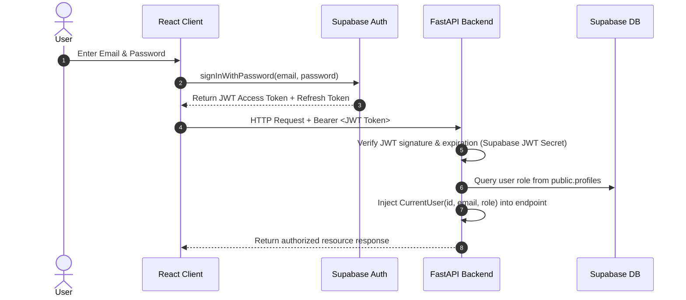

# 🔐 Phase 2: Authentication, Authorization & User Management

## 📌 Phase Summary
Phase 2 establishes user authentication, identity verification, and role-based permissions using Supabase Auth and FastAPI. It ensures that sensitive scan histories remain confidential and accessible solely to their respective owners, while providing elevated controls for system administrators.

---

## 🎯 Objectives & Goals
1. Integrate Supabase Authentication for secure email/password signup, login, and password resets.
2. Build FastAPI dependency injection for JWT verification and user context extraction.
3. Enforce Role-Based Access Control (RBAC) separating **Individual Users** from **Administrators**.
4. Implement privacy controls to prevent unnecessary PII storage on the server.

---

## 👥 User Roles & Permission Matrix

| Feature / Resource | Individual User | Administrator | Unauthenticated Guest |
| :--- | :---: | :---: | :---: |
| Run Ad-hoc Scans (Message, Link, Policy) | ✅ Yes | ✅ Yes | ✅ Yes (Rate-limited) |
| View Personal Scan History | ✅ Yes | ✅ Yes (Own history only) | ❌ No |
| Delete Personal Scan Records | ✅ Yes | ✅ Yes (Own history only) | ❌ No |
| Generate Data Request Letters | ✅ Yes | ✅ Yes | ❌ No (Prompted to login) |
| Save Custom Letter Drafts | ✅ Yes | ✅ Yes | ❌ No |
| View System Health & Total Scan Counts | ❌ No | ✅ Yes | ❌ No |
| View Global Threat Statistics | ❌ No | ✅ Yes | ❌ No |
| Manage User Accounts | ❌ No | ✅ Yes | ❌ No |

---

## 🔑 Authentication Architecture



---

## 🛡️ Security & Privacy Guardrails

1. **Zero Unnecessary Retention:**
   - Raw message content uploaded during scanning is evaluated in-memory and discarded.
   - Only a brief, truncated snippet (e.g. first 80 characters with PII masked) is saved to the user's `scan_history` database record.
2. **Strict Row-Level Security (RLS):**
   - Database queries made by individual users are restricted to `auth.uid() = user_id`.
   - Cross-tenant data leakage is prevented at the database engine level.
3. **Password Security:**
   - Supabase handles password hashing using bcrypt/Argon2. The backend never handles or stores plaintext passwords.
4. **CORS & Token Expiry:**
   - JWT tokens expire automatically; refresh tokens are stored in secure browser storage.
   - Backend restricts origins to trusted domains (`localhost:5173` in development).

---

## 🔌 Authentication Endpoints & Dependencies

### 1. Backend Current User Dependency (`get_current_user`)
- Inspects incoming `Authorization: Bearer <token>` header.
- Validates token against Supabase JWT secret.
- Returns a `UserContext` object with `user_id`, `email`, and `role`.
- Raises `401 Unauthorized` if token is invalid or expired.

### 2. Admin Permission Dependency (`require_admin`)
- Extends `get_current_user`.
- Checks if `user.role == 'admin'`.
- Raises `403 Forbidden` if user is an Individual User.

### 3. User Profile Endpoint
- **Endpoint:** `GET /api/v1/auth/me`
- **Headers:** `Authorization: Bearer <token>`
- **Response:**
  ```json
  {
    "id": "b182c1e8-782a-4dfa-b153-6a988d4c9f11",
    "email": "user@example.com",
    "role": "individual",
    "created_at": "2026-10-13T10:00:00Z"
  }
  ```

---

## ✅ Phase 2 Acceptance Criteria
- [ ] Users can successfully register, verify email, log in, and log out via Supabase.
- [ ] FastAPI securely validates Supabase JWT bearer tokens on protected endpoints.
- [ ] Non-admin users cannot access `/api/v1/admin/*` endpoints (returns `403 Forbidden`).
- [ ] Unauthenticated requests to protected endpoints return `401 Unauthorized`.
- [ ] Database RLS blocks any attempt to view another user's scan history records.
