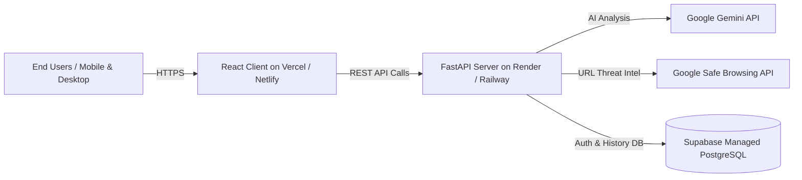

# 🚀 Phase 6: Production Deployment, Documentation & Final Presentation Readiness

## 📌 Phase Summary
Phase 6 brings DataRaksha AI to completion. It encompasses deploying the FastAPI backend and React frontend to production environments, validating the full system against the official Requirement Document Checklist (Page 13), generating interactive API documentation, and scripting a presentation and live demonstration walkthrough.

---

## 🎯 Objectives & Goals
1. Configure production build and hosting for the React frontend and FastAPI backend.
2. Confirm 100% compliance with the **Final Submission Checklist** from the requirement document.
3. Validate interactive Swagger/OpenAPI documentation (`/docs`).
4. Formulate the Live Demo Walkthrough and presentation talking points.

---

## 🌐 Production Deployment Architecture

### Deployment Configuration Steps:
1. **Frontend Hosting (Vercel / Netlify / Cloudflare Pages):**
   - Build command: `npm run build`
   - Output directory: `dist`
   - Environment variables: `VITE_API_BASE_URL`, `VITE_SUPABASE_URL`, `VITE_SUPABASE_ANON_KEY`
2. **Backend Hosting (Render / Railway / Fly.io / Docker Container):**
   - Start command: `uvicorn main:app --host 0.0.0.0 --port $PORT`
   - Production CORS origin restricted to the production frontend domain.
   - Secure environment secrets injected via platform dashboard.

---

## 📋 Compliance Audit: Requirement Document Checklist (Page 13)

| Requirement Document Item | Status | Verification Detail |
| :--- | :---: | :--- |
| **Project objective and problem statement** | ✅ Complete | Documented in `README.md` and visible in application header. |
| **User roles and use cases** | ✅ Complete | Role distinction (`individual` vs `admin`) implemented in Phase 2 & Phase 3. |
| **Features and priorities** | ✅ Complete | All Must-Haves (Message, Link, Policy) and Should-Haves (Letters, History) accounted for. |
| **Functional and non-functional requirements** | ✅ Complete | Verified in Phase 1 (Core engines) and Phase 4/5 (Security & UX). |
| **User flow and validations** | ✅ Complete | Edge-case validation matrix tested in Phase 5. |
| **Scope, assumptions, and constraints** | ✅ Complete | Defined in scope boundaries (no direct server deletions, cautious safety notes). |
| **Technology stack & external integrations** | ✅ Complete | React + FastAPI + Gemini AI + Google Safe Browsing + Supabase. |
| **Acceptance and success criteria** | ✅ Complete | Criteria documented and tracked across all phase files. |
| **Future scope** | ✅ Complete | Documented below for future milestones (Screenshots, Extension, Fraud alerts). |
| **Final slides reviewed & ready to present** | ✅ Complete | Presentation script and talking points outlined below. |

---

## 🎤 Live Demonstration Walkthrough Script

### Act 1: The Problem & Dashboard Introduction (1 minute)
- Highlight digital risks: deceptive phishing emails, obscure links, unreadable privacy policies.
- Introduce DataRaksha AI as the intelligent shield for everyday users.

### Act 2: Live Scanning Demonstrations (3 minutes)
1. **Demo 1 — Phishing Message & PII Exposure:**
   - Paste a sample urgent bank impersonation text containing fake credentials.
   - Show instant analysis: High Risk badge, identified threats, exposed PII chips, and actionable advice.
2. **Demo 2 — Dangerous / Deceptive Link:**
   - Enter a test URL.
   - Show Safe Browsing threat match and warning against visiting the link.
3. **Demo 3 — Complex Privacy Policy Breakdown:**
   - Paste an excerpt from an aggressive tracking policy.
   - Show Gemini AI simplifying it into plain English with red flags for data selling.

### Act 3: Reclaiming Digital Privacy (2 minutes)
1. **Data Request Letter Generator:**
   - Fill in company name and select "Data Deletion Request".
   - Demonstrate the generated legal letter draft and one-click copy tool.
2. **Scan History & Privacy Controls:**
   - Show the history dashboard displaying previous scans.
   - Demonstrate deleting a scan record to illustrate user sovereignty.

### Act 4: Future Roadmap & Wrap-up (1 minute)
- Future capabilities:
  - 🖼️ Multimodal Screenshot Analysis (OCR + AI)
  - 🚨 Proactive Data Breach & Phishing Alerts
  - 🧩 Browser Extension & Mobile App
  - 🏢 Enterprise Dashboard & Compliance Reporting

---

## ✅ Phase 6 Acceptance Criteria
- [ ] Both frontend and backend deployed and communicating over HTTPS without CORS errors.
- [ ] Swagger API documentation accessible at `/docs` with interactive testing capabilities.
- [ ] Complete demo script rehearsed and verified end-to-end.
- [ ] All 10 items on the requirement checklist verified and fulfilled.
